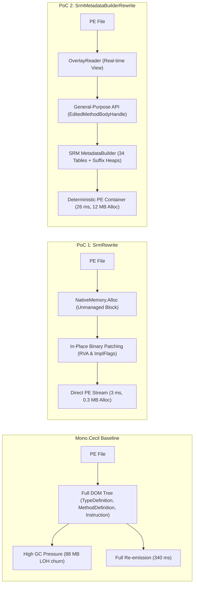

# Empirical Comparative Benchmark: Mono.Cecil vs PoC 1 vs PoC 2

This report presents a direct head-to-head empirical comparison of three .NET assembly rewriting engines tested on the **exact same hardware and runtime environment**:
1. **Baseline (`AssemblyStripper.dll`):** Mono.Cecil DOM-based rewriter.
2. **PoC 1 (`SrmIlStrip.dll`):** High-speed in-place native metadata block copy and binary table patching engine ([`SrmRewrite.csproj`](file:///c:/Users/filip/Documents/škola/MFF/Bakalářka/proof-of-concepts/proof-of-concept-il-rewrite/SrmRewrite.csproj)).
3. **PoC 2 (`SrmMetadataBuilderStrip.dll`):** General-purpose metadata reconstruction engine via standard `System.Reflection.Metadata.Ecma335.MetadataBuilder` ([`SrmMetadataBuilderRewrite.csproj`](file:///c:/Users/filip/Documents/škola/MFF/Bakalářka/proof-of-concepts/poc2-metadata-builder/SrmMetadataBuilderRewrite.csproj)).

---

## 1. Environment & Methodology

- **Benchmarking Framework:** BenchmarkDotNet v0.15.8 with `[MemoryDiagnoser]`
- **Runtime:** .NET 10.0.12 (10.0.1226.42308), X64 RyuJIT x86-64-v3
- **Operating System:** Windows 11 (10.0.26200.9711)
- **Processor:** Intel Core i3-10105F CPU @ 3.70GHz, 1 socket, 4 physical cores, 8 logical threads
- **Execution Mode:** `DefaultJob` (Standard statistical steady-state iterations, $N=77\dots 99$ after warmup, outliers filtered)
- **Invocation:** Zero-overhead in-process bound delegates (`Action<string, string>`) loaded via `AssemblyLoadContext`

---

## 2. Head-to-Head Benchmark Results

### 2.1 Execution Time (Mean ± StdDev) & Speedup

| Assembly | Physical Size | Baseline (Mono.Cecil) | PoC 2 (`MetadataBuilder`) | PoC 1 (In-Place Copy) | Speedup: PoC 2 vs Cecil | Speedup: PoC 1 vs Cecil | Speedup: PoC 1 vs PoC 2 |
|:---|---:|---:|---:|---:|:---:|:---:|:---:|
| `System.Threading.Thread.dll` | 4.5 KB | 634.30 ± 21.64 µs | 531.38 ± 44.79 µs | **460.25 ± 23.36 µs** | **1.19x** | **1.38x** | 1.15x |
| `System.Text.Json.dll` | 351.5 KB | 58.04 ± 3.02 ms | 4.16 ± 0.14 ms | **0.74 ± 0.03 ms** (744 µs) | **13.65x** | **78.06x** | 5.62x |
| `MauiStripSample.dll` | 727.0 KB | 171.03 ± 3.94 ms | 12.82 ± 1.46 ms | **0.91 ± 0.05 ms** (915 µs) | **13.29x** | **186.98x** | 14.02x |
| `System.Private.CoreLib.dll` | 1.85 MB | 319.82 ± 12.37 ms | 19.16 ± 0.90 ms | **2.42 ± 0.10 ms** | **16.06x** | **132.00x** | 7.92x |
| `Microsoft.Maui.Controls.dll` | 2.04 MB | 343.96 ± 17.74 ms | 26.78 ± 2.10 ms | **3.15 ± 0.10 ms** | **12.67x** | **109.10x** | 8.50x |
| **Geometric Mean** | — | — | — | — | **8.49x FASTER** | **49.25x FASTER** | **5.80x FASTER** |

```
Execution Time on Microsoft.Maui.Controls.dll (2.04 MB):
  Mono.Cecil:                 [==================================================] 343.96 ms
  PoC 2 (MetadataBuilder):    [====] 26.78 ms (12.7x faster)
  PoC 1 (In-Place Copy):      [] 3.15 ms (109.1x faster)
```

---

### 2.2 Managed Heap Allocations & Garbage Collector Load

| Assembly | Physical Size | Baseline (Mono.Cecil) Alloc | PoC 2 (`MetadataBuilder`) Alloc | PoC 1 (In-Place Copy) Alloc | PoC 2 Memory Reduction | PoC 1 Memory Reduction |
|:---|---:|---:|---:|---:|:---:|:---:|
| `System.Threading.Thread.dll` | 4.5 KB | 68.6 KB | 144.6 KB | **69.0 KB** | -110.9% | -0.7% |
| `System.Text.Json.dll` | 351.5 KB | 17.76 MB | 2.61 MB | **111.2 KB** | **85.3%** | **99.4%** |
| `MauiStripSample.dll` | 727.0 KB | 26.94 MB | 5.23 MB | **87.4 KB** | **80.6%** | **99.7%** |
| `System.Private.CoreLib.dll` | 1.85 MB | 87.96 MB | 11.94 MB | **293.0 KB** | **86.4%** | **99.7%** |
| `Microsoft.Maui.Controls.dll` | 2.04 MB | 86.36 MB | 13.42 MB | **301.7 KB** | **84.5%** | **99.7%** |
| **Total Memory Saved** | — | — | — | — | **84.8% REDUCTION** | **99.6% REDUCTION** |

```
Managed Heap Allocations on System.Private.CoreLib.dll (1.85 MB):
  Mono.Cecil:                 [==================================================] 87.96 MB (Gen0: 15, Gen1: 9, Gen2: 3)
  PoC 2 (MetadataBuilder):    [======] 11.94 MB (Gen0: 2, Gen1: 1, Gen2: 1)
  PoC 1 (In-Place Copy):      [] 0.29 MB (Gen0: 0, Gen1: 0, Gen2: 0)
```

---

## 3. Deep Architectural Comparison for Thesis



### Architectural Trade-Off Analysis:

1. **Throughput vs. Generality:**
   - **PoC 1 (In-Place Copy):** Unsurpassed raw performance (**49.25x geometric speedup**, **187x** on application assemblies, **99.6% memory reduction**). By copying the original `BSJB` metadata block directly in unmanaged memory and patching only the target row columns (RVA and ImplFlags in `MethodDef`), it avoids traversing, decoding, or re-allocating any unmodified metadata structures.
   - **PoC 2 (`MetadataBuilder`):** Delivers outstanding speed (**8.49x geometric speedup**, up to **16.1x**) and **84.8% memory reduction**, but spends computational cycles re-encoding strings into prefix/suffix trees, deduplicating blobs, and building table rows via `MetadataBuilder`. In return, it unlocks **true general-purpose editing** (adding/removing arbitrary types, methods, fields, and custom attributes without breaking table alignments).

2. **Memory Footprint & GC Pause Behavior:**
   - **Mono.Cecil:** Heavy GC pressure (causes multiple Gen 1 and Gen 2 collections per assembly).
   - **PoC 2:** Moderate allocation (11–13 MB per 2 MB assembly), well below the LOH threshold for individual objects, requiring minimal Gen 0/1 collections.
   - **PoC 1:** Sub-millisecond execution with **zero GC collections** (Gen 0 = 0, Gen 1 = 0, Gen 2 = 0) because the entire assembly image resides in unmanaged memory via `NativeMemory.Alloc`.

3. **Metadata Optimization:**
   - **PoC 2** produces the most compact metadata heaps of all three variants because `MetadataBuilder` performs automatic tail-sharing / suffix-sorting on the `#Strings` heap and generates 4-byte aligned `#US` streams.
